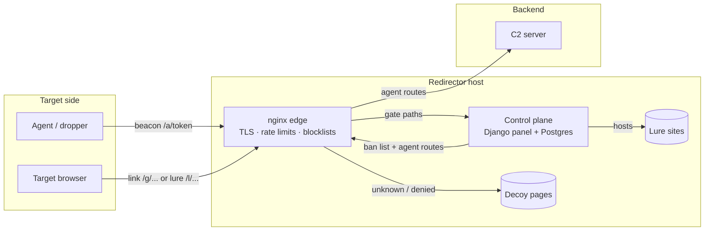
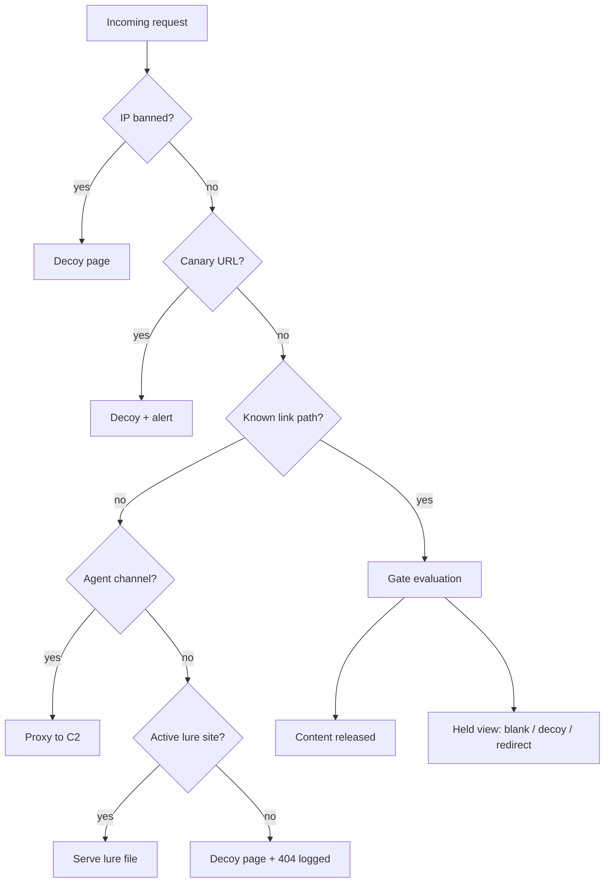
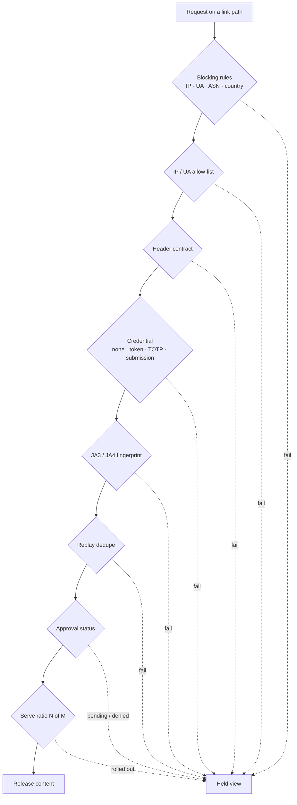
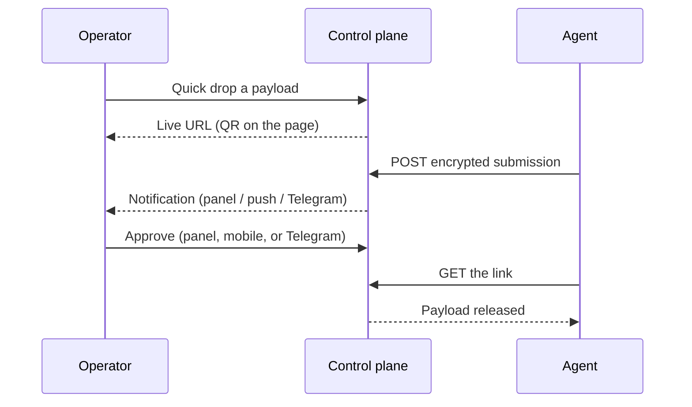
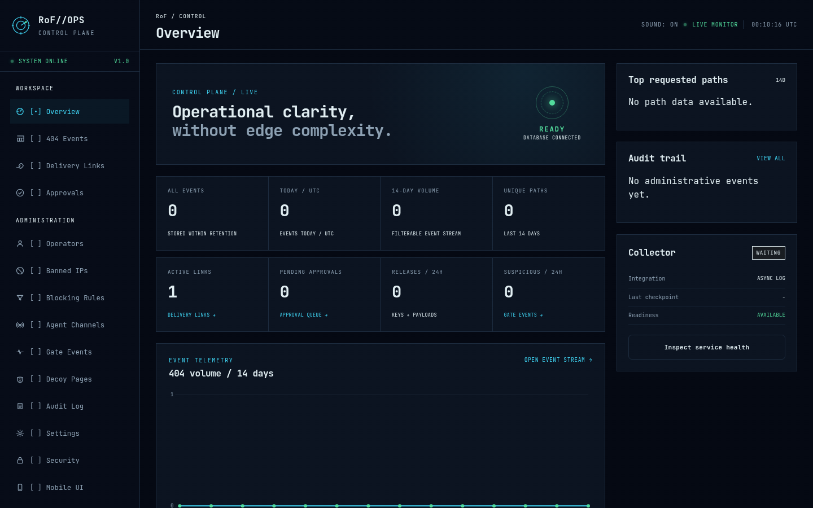
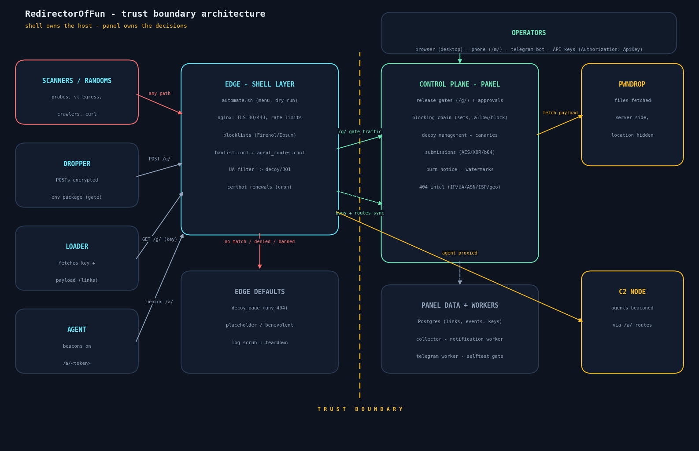
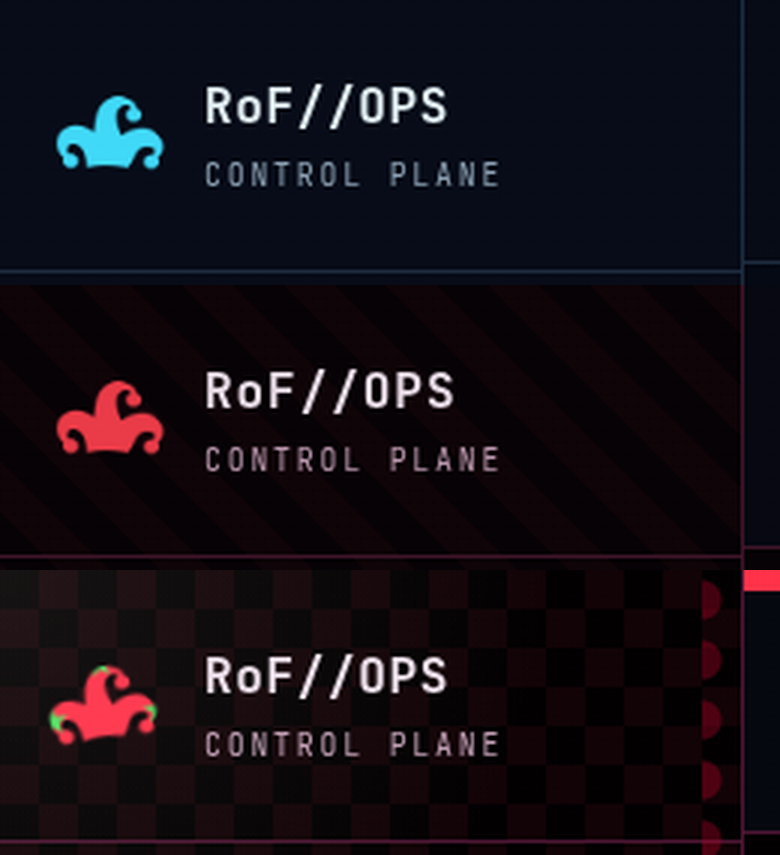

# RedirectorOfFun

**RedirectorOfFun is an nginx C2 redirector with a full operator control plane.**
It serves payloads, keys, and lure sites behind gates that you control.
Visitors that you do not expect get a decoy page. Operators get a panel, an
API, a mobile UI, and Telegram approvals.

---

## How it works

The redirector sits between the target and your C2. The target only ever
sees the redirector. The panel makes all release decisions.

Every public request walks the same decision chain. Visitors that match your
rules get content. Everyone else gets the decoy.

The gate itself checks in a fixed order. A failure at any step looks the same
to the visitor as a wrong token.

## Quick start

1. Copy `.env.example` to `.env`.
2. Run `./start.sh`. The script makes the secrets, builds the images, and
   starts the stack.
3. Open the setup URL from the script output. Claim the administrator account.
4. Go to **Delivery Links**. Use **Quick drop** to serve a file at once, or
   **New link** for full control.

To update later, run `./update.sh`. To wipe and reinstall, run
`./update.sh --reset`.

## Daily use at a glance

## What you can do with it

| You want to | Do this |
|---|---|
| Serve a file now | Quick drop on the Delivery Links page |
| Approve before release | Set the gate to `submission` |
| Serve only to one network | Set the gate to `IP / User-Agent only` and fill the network profile |
| Make a fake site | Create a lure site, or import a bundle from the payload library |
| Hide a payload in a filename | Set **serve as** on the link |
| Watch what targets send | Open **Gate Intel** for decoded screenshots |
| Keep scanners out | Enable presets on the Blocking Rules page |
| Burn an op | Use the burn notice on the link |

## Documentation

| Page | Tells you |
|---|---|
| [docs/deploy.md](docs/deploy.md) | How to install and wire the edge |
| [docs/operations.md](docs/operations.md) | Daily operation and incident response |
| [docs/dsl.md](docs/dsl.md) | Ciphers, auto-rules, gate types, templates |
| [docs/api.md](docs/api.md) | The REST API and API keys |
| [docs/examples.md](docs/examples.md) | Ready-made blocking chains and feeds |
| [docs/openresty-ja3.md](docs/openresty-ja3.md) | JA3/JA4 front layer and JARM notes |
| [SETUP.md](SETUP.md) | Full testlab walkthrough (step by step) |

## Screenshots

Every diagram in the docs is a mermaid block (renders on GitHub). Pre-rendered
SVG copies live in [docs/assets/diagrams/](docs/assets/diagrams/) for offline
reading.

## Themes

The panel has three themes: default, Cozy Clown, and Obnoxious Clown.
Pick yours under Settings.

## Safety notes

> [!WARNING]
> This is dual-use software for authorized security testing. Use it only on
> systems you own or have written permission to test.

> [!CAUTION]
> The one-time setup URL gives administrator access to anyone who opens it.
> Claim it immediately after install.

> [!NOTE]
> Every push runs the full test suite and shellcheck in CI.
