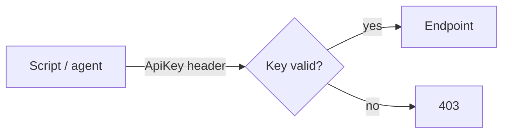

# API Reference

**This page tells you how to drive the control plane over REST.** Every panel
feature has an API endpoint. Use an API key for scripts; the session cookie
works too.

## Authenticate

Create a key under Security → API keys. Send it in the `Authorization` header.

```bash
curl -H "Authorization: ApiKey rofk_..." https://panel/<prefix>/api/v1/gate-stats/
```



Keys can expire and can be revoked at any time. A revoked or wrong key gets
`403`. The API lives under the operator prefix like every operator path.

## Links

| Method | Path | Purpose |
|---|---|---|
| GET/POST | `links/` | List / create delivery links |
| GET/PATCH/DELETE | `links/<id>/` | Read / update / delete |
| POST | `links/<id>/burn/` | Burn: deactivate + ban visitor IPs |

Writable fields include `path`, `kind`, `key_text`, `pwndrop_url`, `gate_type`,
`gate_token`, `totp_secret`, `totp_window`, `cipher`, `cipher_key`, `cipher_iv`,
`expected_fields`, `auto_rules`, `placeholder`, `on_deny`,
`requires_approval`, `one_time`, `max_uses`, `expires_at`, `active`, `domain`,
`ja3_fingerprint`, `ja4_fingerprint`, `watermark`, `payload`, `benevolent_file`,
`serve_as`, `allowed_uas`, `allowed_ips`, `header_contract`, `replay_dedupe`,
`active_window_start`, `active_window_end`, `serve_num`, `serve_den`.

Notes on the less obvious fields:

- `payload` and `benevolent_file` are file fields. Send them as multipart form
  data. Reads return the file URL. `payload_size` is read-only.
- `serve_as` renames the download for the visitor only.
- `allowed_ips` takes IPs or CIDRs. `allowed_uas` takes UA regex patterns.
- `header_contract` is the malleable contract: `{"name", "value"}` for an
  exact match or `{"name", "pattern"}` for a regex fullmatch.
- `active_window_start` / `active_window_end` take `"HH:MM"` in UTC. The
  window can cross midnight.
- `serve_num` / `serve_den` set the serve ratio (`1/20` serves about 5% of
  passing requests).

## Submissions

| Method | Path | Purpose |
|---|---|---|
| GET | `submissions/?status=pending` | Approval queue |
| POST | `submissions/<id>/approve/` `…/deny/` | Decide (409 if already decided) |
| POST | `submissions/<id>/undo/` | Revert within the undo window |
| POST | `submissions/<id>/note/` | Body: `{"note": "..."}` |
| GET | `submissions/image/<id>/` | Decoded image bytes |

Submissions nest their images with `id`, `field_name`, `content_type`, `url`.

## Lures (hosted multi-page sites)

Lures are served publicly at `<LURE_BASE_PATH><slug>/<file>` (default `/l/`).

| Method | Path | Purpose |
|---|---|---|
| GET/POST | `lures/` | List / create sites |
| GET/PATCH/DELETE | `lures/<id>/` | Manage a site (includes nested `files` and `public_path`) |
| PUT | `lures/<id>/file/` | Upsert a file: `{"path": "index.html", "content": "..."}` |
| DELETE | `lures/<id>/file/` | Remove a file: `{"path": "index.html"}` |

## Decoys

| Method | Path | Purpose |
|---|---|---|
| GET/POST | `decoys/` | List / create decoy pages |
| GET/PATCH/DELETE | `decoys/<id>/` | Manage (writable `html` overrides the source; `assets` nested read) |
| POST | `decoys/<id>/default/` | Make the default cover page |
| PUT | `decoys/<id>/asset/` | Upsert a tied asset: `{"path": "style.css", "content": "..."}` |
| DELETE | `decoys/<id>/asset/` | Remove an asset |

Decoy assets are served publicly at `/d/<page id>/<path>`.

## Bans, agents, telemetry

| Method | Path | Purpose |
|---|---|---|
| GET/POST | `bans/` | List / create (`{"ip", "note"}`) |
| GET/PATCH | `bans/<id>/` | Read / enable / disable |
| GET/POST | `agents/` | Per-agent C2 channels |
| GET/PATCH/DELETE | `agents/<id>/` | Manage channel |
| POST | `agents/<id>/rotate/` | New token (burns the deployed agent) |
| GET | `hit-events/?category=suspicious` | Gate telemetry (cursor-paginated) |
| GET | `gate-stats/` | 24h aggregates + pending counts |

## Blocking rules

| Method | Path | Purpose |
|---|---|---|
| GET/POST | `block-rules/` | List / create rules |
| GET/PATCH/DELETE | `block-rules/<id>/` | Read / update / delete (presets cannot be deleted) |
| GET/POST | `block-rules/sets/` | List / create rulesets |
| GET/PATCH/DELETE | `block-rules/sets/<id>/` | Manage a ruleset (deleting orphans its rules) |
| POST | `block-rules/reorder/` | `{"kind": "rule"|"set", "ids": [...]}` rewrites ordering |
| GET | `block-rules/export/` | Download the full chain as JSON |
| POST | `block-rules/import/` | Import a JSON export (lands disabled) |
| POST | `block-rules/test/` | Dry-run `{"ip", "ua"}` against every rule |

## Web Push

| Method | Path | Purpose |
|---|---|---|
| GET | `push/key/` | VAPID public key + configured flag |
| POST | `push/subscribe/` | Body: PushSubscription JSON |
| POST | `push/unsubscribe/` | Body: `{"endpoint"}` |

## Operators, system

| Method | Path | Purpose |
|---|---|---|
| GET | `operators/` | List (admins) |
| POST | `operators/<id>/reset-2fa/` | Clear a lost second factor (admins) |
| GET/POST | `apikeys/` | List / mint keys |
| POST | `apikeys/<id>/revoke/` | Revoke (own keys; admins any) |
| GET | `selftest/` | Run the self-test battery |
| GET | `gate-config/` | Code format, base paths, feature flags |

> [!NOTE]
> List endpoints that paginate return `{"count", "next", "results"}`.
> `links/` and `submissions/` return plain arrays.
