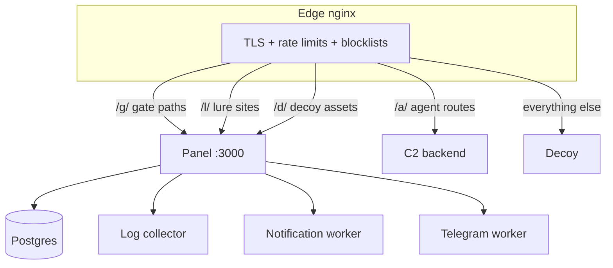

# Deployment

**This page tells you how to install the control plane and connect the edge.**
The fast path is `./start.sh` (Docker). The manual path is below.

> [!NOTE]
> The edge (nginx) stays simple. All release decisions live in the panel.

## Where requests go



nginx includes two files that the panel manages:

| File | Contains |
|---|---|
| `/etc/nginx/banlist.conf` | `deny` lines for banned IPs |
| `/etc/nginx/agent_routes.conf` | exact-match agent beacon locations |

`automate.sh` creates both files, empty, at setup. After a ban or agent
change, reload nginx. `manage.py sync_nginx` prints the reminder.

## Install with Docker

1. Copy the example environment: `cp .env.example .env`.
2. Fill in the secrets. Telegram and Web Push keys are optional.
3. Run `./start.sh`.
4. Open the setup URL from the output and claim the administrator account.

The compose stack starts five services: panel, Postgres, log collector,
notification worker, Telegram worker. A web tier serves ports 80 and 443.

## Install on bare metal

1. Install Python 3.12.
2. Run `pip install -r requirements.txt`.
3. Run `python manage.py migrate`.
4. Point `PANEL_UPSTREAM` in the nginx config at the panel (default
   `127.0.0.1:3000`).

The container boot runs self-tests (`manage.py selftest --strict`).

> [!WARNING]
> Set `SELFTEST_SKIP=true` only to recover a broken deployment. A skipped
> self-test can hide a broken gate configuration.

## Use more than one domain

1. Point all DNS names at the same host.
2. List them in `REDIRECTOR_DOMAINS`, comma-separated.
3. Add them to the nginx `server_name` line.

You can then pin each link to one domain. When a domain gets reported, move
the links to another domain in the panel. The payloads do not change.

```bash
REDIRECTOR_DOMAINS=updates.example.com,cdn.example.net
```

```nginx
server_name updates.example.com cdn.example.net;
```

## Gate by TLS fingerprint (JA3/JA4)

Stock nginx does not expose the ClientHello fingerprint. Put an OpenResty or
HAProxy front layer in front of the edge to compute it. The front layer must
set `X-JA3-Fingerprint` / `X-JA4-Fingerprint` on every request.

See [openresty-ja3.md](openresty-ja3.md) for a working setup.

> [!CAUTION]
> The front layer must overwrite these headers on every request. If a
> client-supplied value reaches the panel, the fingerprint gate is spoofable.
> A fingerprint-gated link refuses to serve when the header is missing.

## Client addresses

> [!WARNING]
> Docker note: the web tier reaches the panel from a bridge address. Keep
> `172.16.0.0/12` in `TRUSTED_PROXIES` (the default since this fix), or every
> visitor appears as the web tier and bans blackhole all of them. The panel
> refuses to ban proxy and loopback addresses.


`TRUSTED_PROXIES` (default `127.0.0.1,::1`) lists the only peers whose
`X-Forwarded-For` header the panel believes. Keep this list to your real edge
proxies. This stops XFF spoofing from evading bans.

## Threat-intel blocklist

`blocklist-update.sh` writes `/etc/nginx/blocklist.conf` from Firehol L1 and
Ipsum (score 3 and up). Three ban layers stay separate:

1. Threat-intel blocklist (external sources)
2. Operator bans (manual)
3. Auto-bans (from rules and burn notices)

## Watermark prefix

Watermarks mark every release from a watermarked link. The prefix derives
from a per-deployment secret, so it differs across deployments by default.
Set `WATERMARK_PREFIX` in `.env` only to force your own.

## Track all requests

The events page stores 404s by default. Set `TRACK_ALL_REQUESTS=1` in `.env`
to store every request (2xx included). Recreate the web and collector
containers after a change.

## Backups

1. Dump the database with `pg_dump`.
2. Copy `./data/` (uploaded files, extracted images, the payload library,
   your custom pages, and surface-document overrides).

> [!WARNING]
> The database holds link configurations, keys, and submission contents.
> Treat it like a loot repository. Test your restores.
