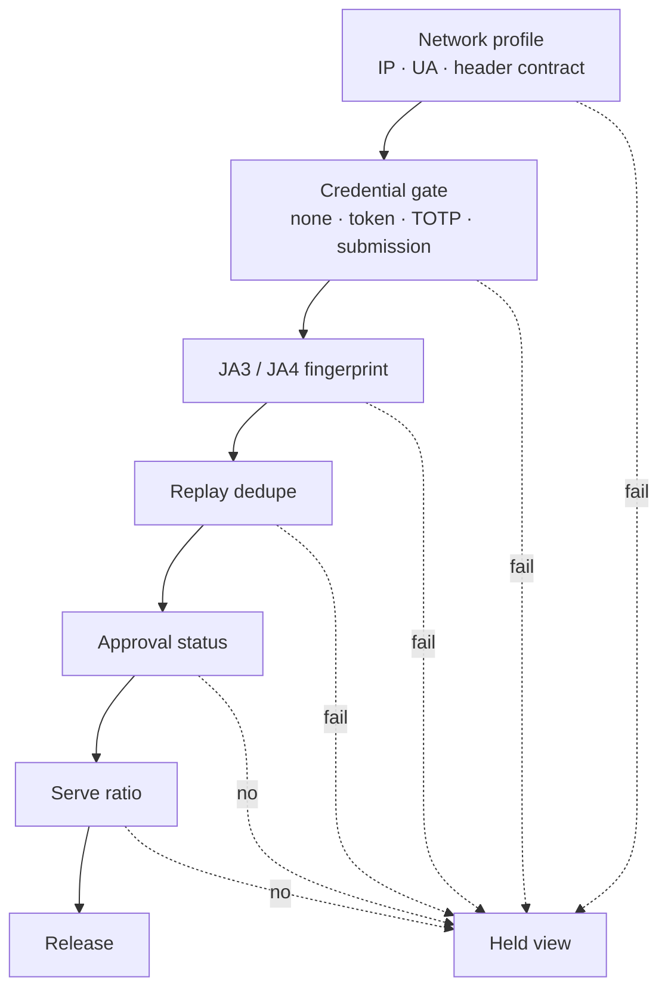
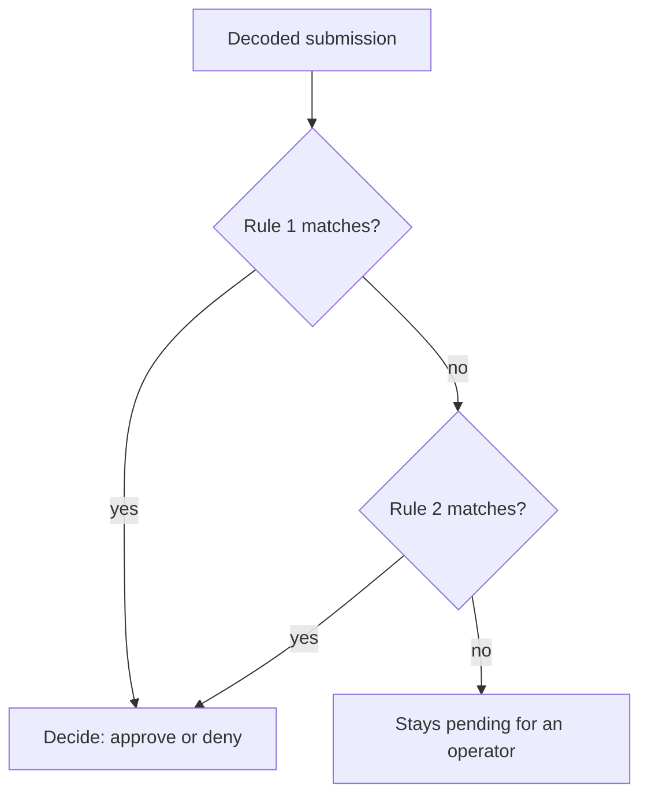

# DSL Reference

**This page is the reference for the configuration languages in the control
plane:** submission ciphers, auto-decision rules, gate types, and link
templates.

## Gate types

| Gate | The visitor presents | On failure |
|---|---|---|
| `none` | the path only | held view |
| `token` | `?t=` or the `X-Gate-Token` header | held view + suspicious event |
| `totp` | a time-based code, single-use per link | held view + suspicious event |
| `submission` | an encrypted POST body | held view |
| `network` | nothing - the IP/UA allow-lists decide | held view + suspicious event |

The network profile (IP allow-list, UA allow-list, header contract) runs
before the credential check on every gate type.

> [!NOTE]
> A TOTP code works once per link. A replayed code is rejected and logged.
> Pick the code format (8-hex or 6-digit) under Settings.

## The checks run in a fixed order



A failure at any step looks the same to the visitor.

## Submission cipher templates

The submission gate decodes the POST body with one template. The body can be
the raw blob or a JSON wrapper: `{"data": "<blob>"}`.

| Template | Key | IV | Output |
|---|---|---|---|
| `base64` | - | - | raw bytes (must be JSON) |
| `xor` | passphrase | - | base64(blob) XOR key bytes, repeating |
| `aes256` | 32-byte hex, or passphrase (SHA-256) | 16-byte hex | AES-256-CBC, PKCS7 |

After decoding, the payload must be a JSON object. It must contain every
field in `expected_fields`. String fields that base64-decode to image magic
bytes (PNG, JPEG, GIF, BMP) become images on the submission.

## Auto-decision rules

```json
[
  {"action": "approve",
   "when": {"fields_match": {"hostname": "^corp-laptop-\\d+$"},
            "forbid": ["vmware|virtualbox", "sandbox"],
            "require_images": true}},
  {"action": "deny",
   "when": {"fields_match": {"hostname": "^sandbox"}}}
]
```

The rules run top-down. The first match decides the submission. No match
means the submission waits for a human.



- `fields_match`: every listed field must exist and match its regex.
- `forbid`: if any decoded value matches any forbid regex, the rule is
  skipped. A forbid match cannot deny by itself. Write an explicit deny rule
  for patterns you want dead.
- `require_images`: at least one image must be extracted.

Each auto-decision records `via: auto-rule#<index>` in the hit detail.

## Hold responses

| Setting | The held visitor gets |
|---|---|
| `blank` | HTTP 204, empty body |
| `placeholder` | a generic page |
| `decoy` | the default decoy page |

## Deployment templates

Load a preset from the link form. Replace the `{placeholder}` values.

| Template | Use it for |
|---|---|
| `dropper-checkin` | encrypted environment package, approval before key release |
| `key-drop-one-time` | TOTP-gated, single-retrieval key |
| `loader-stage` | token-gated file with limited uses |
| `file-drop` | pwndrop proxy, 10 uses, watermarking on |
