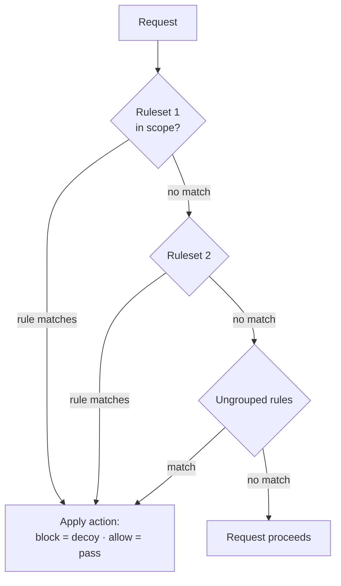

# Example rules and rulesets

**This page shows ready-made blocking chains and how to import them.**
Everything imports disabled. Test on the dry-run page before you enable.

The chain walks ordered rulesets, then ungrouped rules. The first match wins.



Import from the Blocking Rules page or with `POST /api/v1/block-rules/import/`.

## scanner-defense.json

One set with three block rules: VirusTotal egress, AWS cloud scanners (ASN
`16509`/`14618` and a script-like UA), and scripting user agents (`curl`,
`wget`, python-requests, go-http-client).

## allow-soc-block-rest.json

The chain-ordering demo. An ALLOW rule for the SOC laptop's IP runs first. A
BLOCK for everyone (`ua is anything`) runs second. The operator passes. The
rest of the internet gets the decoy.

## 404-probes-only.json

Scoped to 404s. Known scanner fingerprints get blocked on probe paths. A
second rule blocks non-browser UAs from non-loopback addresses. Gate links
keep working normally.

## single-link-guard.json

Scoped to one delivery link (`/g/drop/example` - edit the path to yours).
Blocks any visitor whose ASN is not the customer's, plus VirusTotal anywhere.

## Quick rule generator

On the Blocking Rules page, **Quick rule generator** builds conditions from
questions: what to check (IP, CIDR, UA, ASN, ISP, country, city), how to
compare, and the value. The preview shows the regex and the JSON before you
create the rule.

| Question | Regex |
|---|---|
| starts with `x` | `^x` |
| contains `x` | `x` |
| is `x` | `^x$` |
| is not `x` | `^x$` + negate |
| doesn't contain `x` | `x` + negate |
| ends with `x` | `x$` |
| is anything | `.*` |
| is not empty | `.+` |
| is empty | `^$` |

Values are regex-escaped for you. CIDR conditions only offer is/is-not.

## Vendor and scanner IP feeds

`import_ip_feed` pulls a remote IP/CIDR feed into a blocking ruleset. Plain
text and CSV work; `#` starts a comment. Each run replaces the ruleset's
rules, so it is safe to cron:

```bash
# refresh twice a day
17 */12 * * *  cd /opt/rof && docker compose exec -T panel \
  python manage.py import_ip_feed --url https://example.org/vendor-ranges.txt
```

Options: `--name` picks the ruleset (default "Vendor feed blocklist"),
`--disabled` imports without enabling, `--action allow` makes an allow-list.
A JSON body in the rof-blocking-rules export format goes through the normal
importer instead.

Pair feed sets with `country` / `asn` / `isp` conditions for
enrichment-based filtering.
