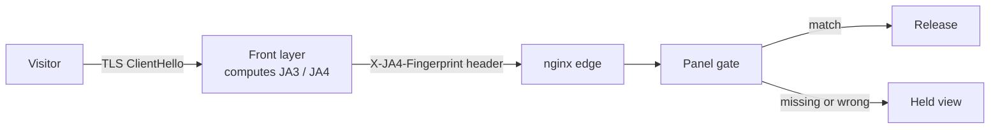

# JA3/JA4 fingerprint gating

**This page tells you how to gate links by the visitor's TLS fingerprint.**
Stock nginx cannot compute ClientHello fingerprints. You need a front layer
(OpenResty or HAProxy) that computes JA3/JA4 and adds them as headers.



## Option A: OpenResty with lua-resty-openssl (recommended)

Install OpenResty and `lua-resty-openssl`. Compute the fingerprint in the
`ssl_client_hello_by_lua_block` phase and store it in a variable.

```nginx
# /etc/openresty/conf.d/fingerprint.conf
server {
    listen 443 ssl;
    server_name updates.example.com;

    ssl_certificate     /etc/letsencrypt/live/updates.example.com/fullchain.pem;
    ssl_certificate_key /etc/letsencrypt/live/updates.example.com/privkey.pem;

    ssl_client_hello_by_lua_block {
        local ssl = require "ngx.ssl"
        local ja4 = require "ja4"           -- e.g. lua-ja4 / your own module
        local chain = ssl.get_client_hello()
        if chain then
            local fp = ja4.compute(chain)
            ngx.var.ja4_fp = fp
        end
    }

    # proxy everything to the stock nginx edge (or directly to panel/C2)
    location / {
        proxy_pass http://127.0.0.1:8080;
        proxy_set_header X-JA4-Fingerprint $ja4_fp;
        proxy_set_header X-JA3-Fingerprint $ja3_fp;   -- if your module also emits JA3
        proxy_set_header Host $host;
        proxy_set_header X-Forwarded-For $proxy_add_x_forwarded_for;
        proxy_set_header X-Real-IP $remote_addr;
    }
}
```

JA4 is preferred over JA3: it is sortable, it includes the TLS version and
ALPN, and it degrades gracefully. Reference: <https://github.com/FoxIO-LLC/ja4>.

## Option B: HAProxy with fingerprint ACLs

HAProxy 2.8+ matches ClientHello fingerprints natively
(`ssl_fc_ja4_hash`, `ssl_fc_ja3_hash` with the right build). This is the
cheapest path if you prefer not to run Lua:

```
frontend edge
    bind :443 ssl crt /etc/haproxy/updates.pem
    http-request set-header X-JA4-Fingerprint %[ssl_fc_ja4_hash]
    http-request set-header X-JA3-Fingerprint %[ssl_fc_ja3_hash]
    default_backend nginx_edge
```

## On the panel side

Set `ja3_fingerprint` / `ja4_fingerprint` on the link (in the collapsed
FINGERPRINTS & WATERMARKING section of the link form). The gate requires an
exact match. A missing header fails closed: if the front layer is absent or
bypassed, the link denies instead of downgrading.

Test the header path:

```bash
curl -sI -H "X-JA4-Fingerprint: <expected>" https://updates.example.com/g/<path>
```

> [!WARNING]
> The front layer must overwrite these headers on every request. If a
> client-supplied value reaches the panel, the gate is spoofable.

> [!NOTE]
> Fingerprints change when the beacon's TLS stack changes. Verify them per
> build. Expect rotation.

Keep the front layer quiet: it must show the same decoy behavior as the edge
for non-gate paths.

## JARM rotation (edge layer)

JA3/JA4 checks the client. The redirector's own TLS fingerprint (JARM) is
fixed per build and config, so a deployment is scannable across engagements.
Rotation is an edge-layer task; the panel cannot change it.

- Rebuild or reconfigure the TLS stack per deployment (cipher list, TLS
  version floor, ALPN order) so the JARM changes every time.
- Or put a rotating TLS terminator in front (a pool of OpenResty builds, or a
  CDN front) and switch on a schedule.
- Track your current JARM (`jarm scan <domain>`) in pre-flight checks. If it
  lands on a public blocklist, rotate before the op starts.

Treat JARM like the randomized gate and agent bases: per deployment, never
shared.
