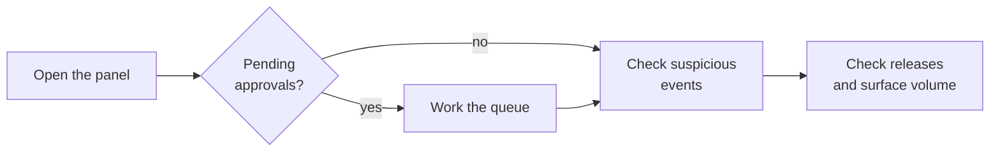
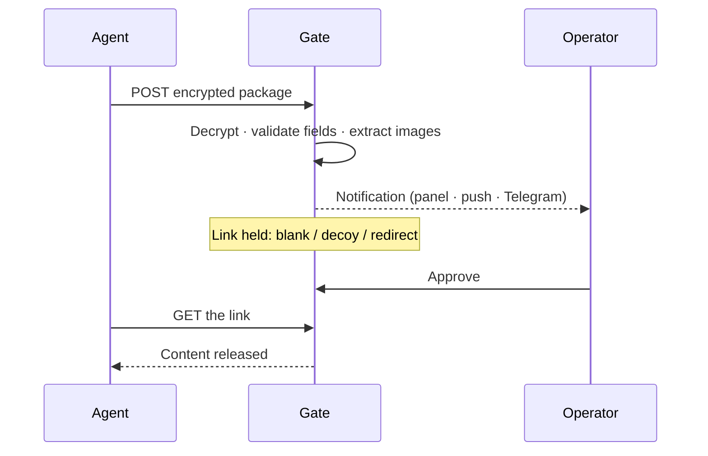
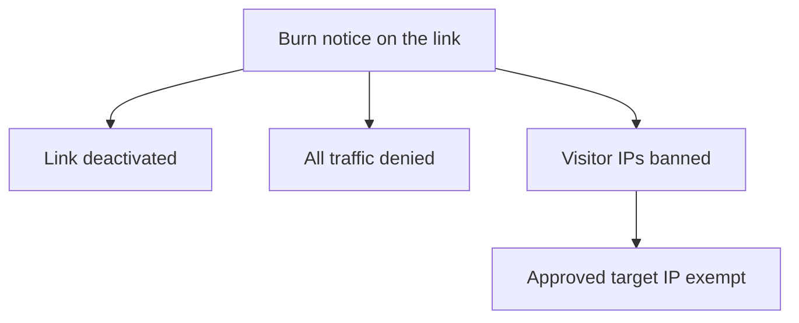

# Operations

**This page tells you how to run the control plane each day and how to react
when something burns.** Install first: see [deploy.md](deploy.md).

## The morning loop

1. Open the panel. The gate strip shows pending approvals, releases in the
   last 24 hours, and suspicious events.
2. Work the approval queue. Use the keyboard: `j` / `k` move, `a` approve,
   `d` deny, `u` undo.
3. Expand a row to see the decoded JSON and the extracted screenshots.
4. Check Gate Intel for imagery from the last day.

On a phone, use the mobile UI (`/m/`) or reply to the Telegram bot:
`approve 42`, `deny 42`, `pending`.

## How a submission becomes a release

## Approve safely

- The decoded JSON and the screenshots are your evidence. Check the hostname
  against the naming convention. Look for VM artifacts and timezone
  mismatches.
- `forbid` patterns in auto-rules are the safety net. A rule never fires when
  a forbidden value is present.
- Tick **REMEMBER** when you decide. The decision becomes a learned auto-rule
  (exact field match) on that link. The next matching submission decides
  itself. Edit or remove learned rules on the link form.
- Deny sends the response you set on the link: 404, decoy, or your benevolent
  content. Configure the benevolent response before the engagement.

## Campaigns and per-target IDs

Group links and lures into a named campaign (Delivery Links → Campaigns).
Stats roll up on the campaign page. For per-target tracking, set a track
param on a link (`?ffs=403230`); an ID-tracked link shows the decoy for any
unregistered ID. Batch generate mints N links with random paths and
registered IDs in one step.

## When a link is blown

The burn notice is one click. It deactivates the link, denies all traffic,
and bans every visitor IP except the approved target. Use it when an op is
blown.

## Serve ratios

A link can serve the payload on only some passing requests (for example
`1/20`). The rest see the held view. Use this to slow scanners while the real
target retries. Failed rolls never consume uses.

## Regular care

- Run `./update.sh` to update. Run `./update.sh --reset` for a clean install.
- Check Service Health when something looks wrong.
- Rotate agent channels after a rebuild of the agent.
- Review Banned IPs weekly. Lift stale entries.
